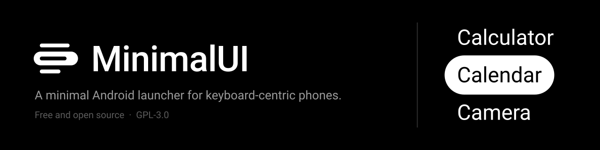

# MinimalUI

A minimal Android launcher for keyboard-centric phones, such as those from Zinwa, Clicks and Unihertz. Inspired by
[MinUI](https://github.com/shauninman/MinUI) and [Cannoli](https://github.com/CannoliHQ/cannoli): a plain list of
apps, driven entirely by keys.

## Status

Early development (version 0.1.0). There are no releases yet, and no phone is listed as supported until it has been
tested on one: [`DEVICES.md`](DEVICES.md) lists the phones reported so far and how to report yours. Today the launcher
shows every installed app in one alphabetical list and opens the one you pick. It hides Android's status bar and shows
its own pill in the top-right corner instead: Wi-Fi (when connected), battery level and the time.

## Requirements

Android 9 (API 28) or newer. A hardware keyboard or D-pad is the intended input; touch also works.

## Installing

Pick one:

- **Download a build.** Every CI run on GitHub uploads a debug APK as the `minimalui-debug-apk` artifact, kept for 14
  days. Open a recent run of the `CI` workflow under the repository's **Actions** tab (you must be signed in to GitHub),
  download the artifact, unzip it, and install `app-debug.apk` on the phone. You can do this with `adb install
  app-debug.apk`, or by opening the file on the phone and allowing installs from that source.
- **Build from source.** Follow [Getting started](CONTRIBUTING.md#getting-started) in `CONTRIBUTING.md`, then run
  `./gradlew installDebug` with the phone connected.

## Making it your home screen

After installing, choose MinimalUI as the default home app. On most phones the setting is under **Settings → Apps →
Default apps → Home app**; the exact wording varies by manufacturer.

To switch back, open **Settings** from the MinimalUI list (MinimalUI keeps it in the list for this) and choose
another home app in the same place.

## Keys

| Key                          | Action                                                                        |
| ---------------------------- | ----------------------------------------------------------------------------- |
| Up / Down (arrows, D-pad)    | Move one row. A fresh press past either end wraps around; holding stops there |
| Left / Right (arrows, D-pad) | Turn a page, stopping at the first or last app                                |
| Left / Right in settings     | Change the highlighted setting to its previous / next value, wrapping around  |
| Enter or D-pad centre        | Open the highlighted app; in the app menu, do the highlighted action          |
| Enter in settings            | Change the highlighted setting to its next value, or open About               |
| Menu, or hold Enter / centre | Open the highlighted app's menu (touch: long-press the app)                   |
| Back or Esc                  | Close the app menu, settings or About; does nothing on the home screen        |
| Home                         | Close any menu or settings and return to the top of the list                  |

The home screen is one list. At its top, the apps you opened last from MinimalUI, newest first, then one blank row,
then every app in alphabetical order (the recent ones too). Up and Down skip the blank row. The **Recently used**
setting picks how many recent apps show there: Off, 3 (the default), 5 or 15. Typing filters all apps and hides the
recent block until the filter is cleared.

The list updates on its own when apps are installed or removed. Apps open without a transition animation. Coming
back from an app by Back, Recents or the app closing selects that app again, so one press reopens it; the filter
stays. Home instead clears the filter and returns to the top.

The app menu replaces the list until it is closed: App info, Uninstall (dim and inactive for system apps and the
Settings entry), and, when there are recently used apps, Remove from recently used and Clear recently used. After an
action, Back or Esc, the list comes back with the same app highlighted.

MinimalUI's own settings open from the **MinimalUI settings** row, listed right after Android's Settings (type `min`
to find it). They replace the list until closed, the way the app menu does: Clock and Battery percentage show or hide
those items in the status pill (both on by default), Recently used sizes the block at the top of the list, and About
at the bottom shows the version and the commit the app was built from. Settings are kept in the app's private
storage.

## Contributing

See [`CONTRIBUTING.md`](CONTRIBUTING.md) for setup, project layout and the quality gates. AI agents follow
[`AGENTS.md`](AGENTS.md).

## Licence

[GNU General Public License v3.0](LICENSE).
