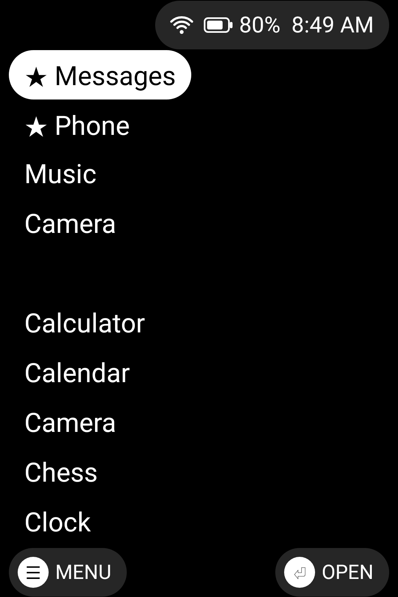
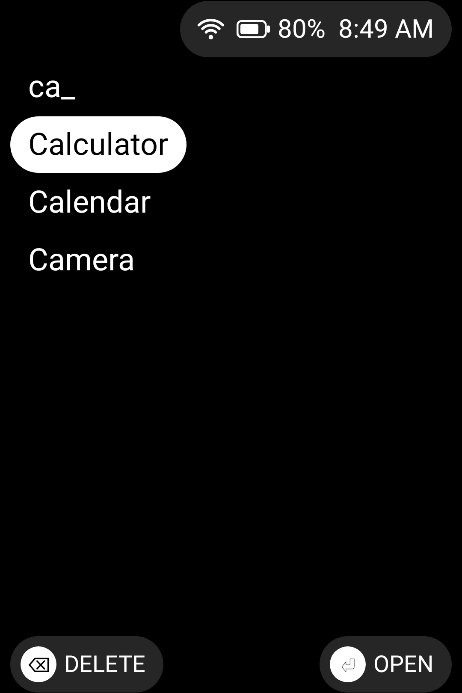
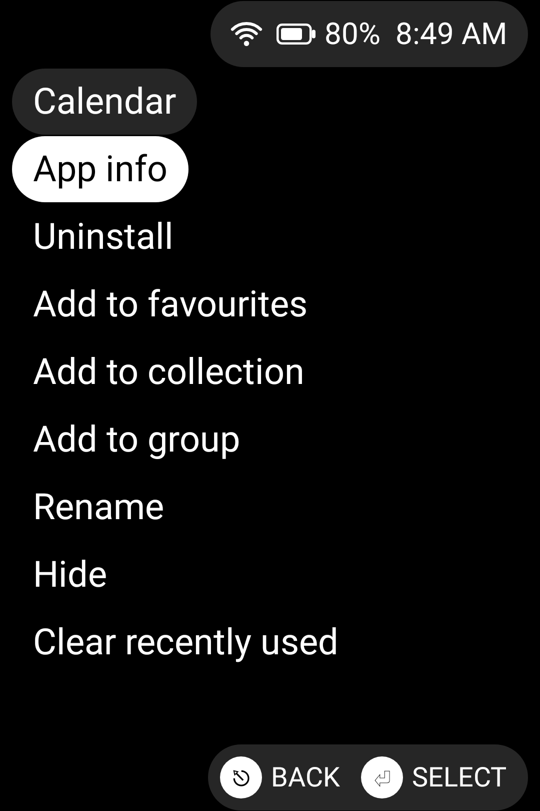
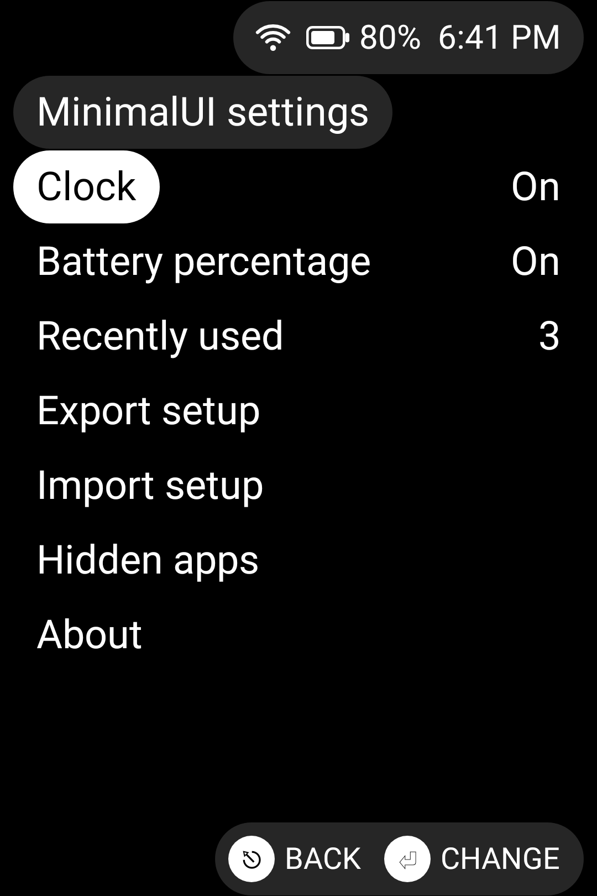
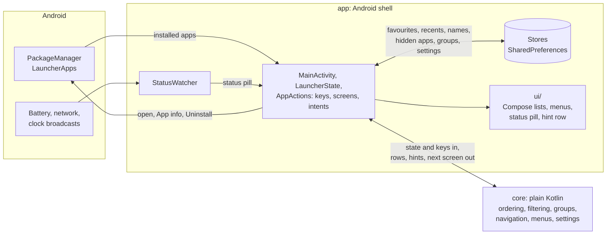
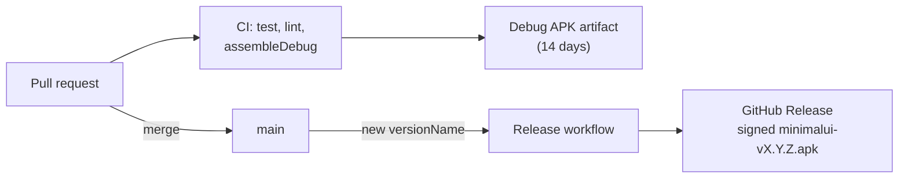

<div align="center">


[Download](https://github.com/Tim-van-Oudheusden/MinimalUI/releases/latest) · [Introduction video](https://youtu.be/pnP0TemZbZI) ·
[Devices](DEVICES.md) · [Project page](https://buildwithtim.dev/projects/minimal-android-launcher)

[](https://github.com/Tim-van-Oudheusden/MinimalUI/actions/workflows/ci.yml)
[](https://github.com/Tim-van-Oudheusden/MinimalUI/actions/workflows/coverage-gate.yml)
[](https://github.com/Tim-van-Oudheusden/MinimalUI/releases/latest)
[-3DDC84?logo=android&logoColor=white)](#requirements)
[](LICENSE)
[](https://github.com/Tim-van-Oudheusden/MinimalUI/commits/main)

</div>

<p align="center">
  
  
  
  
</p>

## Status

Early development (version 0.1.0). No phone is listed as supported until it has been tested on one:
[`DEVICES.md`](DEVICES.md) lists the phones reported so far and how to report yours. Today the launcher
shows every installed app in one alphabetical list and opens the one you pick. It hides Android's status bar and shows
its own pill in the top-right corner instead: Wi-Fi (when connected), battery level and the time.

## About

A minimal Android launcher for keyboard-centric phones, such as those from Zinwa, Clicks and Unihertz. Inspired by
[MinUI](https://github.com/shauninman/MinUI) and [Cannoli](https://github.com/CannoliHQ/cannoli): a plain list of
apps, driven entirely by keys.

[](https://youtu.be/pnP0TemZbZI)

Watch the [introduction video](https://youtu.be/pnP0TemZbZI) on YouTube.

- **Keyboard first.** Every action has a key, and the bottom row of each screen names the keys that work there. Touch
  works too, but is never needed.
- **One list.** Favourites, then the apps you opened last, then every app in alphabetical order. Type to filter it.
- **Collections and groups.** Named lists of apps in your own order, and groups by the category each app declares, with
  work-profile apps in a group of their own.
- **Your names, your list.** Rename or hide any app; hidden apps stay findable by typing their name.
- **Less on screen.** Black and white, no icons, no transition animations. A small pill replaces Android's status bar
  with Wi-Fi, battery and the time.
- **Offline.** No internet permission, and no permission that needs your approval.

## Requirements

Android 9 (API 28) or newer. A hardware keyboard or D-pad is the intended input; touch also works.

## Installing

Pick one:

- **Download a release.** [Releases](https://github.com/Tim-van-Oudheusden/MinimalUI/releases) lists every published
  version with `minimalui-<version>.apk` attached; no GitHub account is needed. Open the file on the phone and allow
  installs from that source, or run `adb install minimalui-<version>.apk`. A release installs over an earlier one and
  keeps your settings. A debug build (the next two options) is signed with a different key, so uninstall it first.
- **Download a CI build.** Every CI run on GitHub uploads a debug APK of the latest code as the `minimalui-debug-apk`
  artifact, kept for 14 days. Open a recent run of the `CI` workflow under the repository's **Actions** tab (you must
  be signed in to GitHub), download the artifact, unzip it, and install `app-debug.apk` on the phone. You can do this
  with `adb install app-debug.apk`, or by opening the file on the phone and allowing installs from that source.
- **Build from source.** Follow [Getting started](CONTRIBUTING.md#getting-started) in `CONTRIBUTING.md`, then run
  `./gradlew installDebug` with the phone connected. No phone at hand? [Running it in an emulator on
  Linux](CONTRIBUTING.md#running-it-in-an-emulator-on-linux) sets one up.

## Making it your home screen

After installing, choose MinimalUI as the default home app. On most phones the setting is under **Settings → Apps →
Default apps → Home app**; the exact wording varies by manufacturer.

To switch back, open **Settings** from the MinimalUI list (MinimalUI keeps it in the list for this) and choose
another home app in the same place.

## Keys

The bottom row of every screen is a hint row, as in MinUI: it names the keys that work on the screen and the selected
row by their glyphs, `⏎` Enter, `⎋` Esc (or Back), `☰` Menu and `⌫` Backspace, with what each does, for example
`☰ MENU` on the left and `⏎ OPEN` on the right of the home screen, `⌫ DELETE` while filtering, `⎋ BACK  ⏎ OPEN` in
a list opened from it and `⎋ CANCEL  ⏎ SAVE` in the text editor. Tapping a hint does the same as pressing its key, so
the keys also work by touch. Screens narrower than 320 dp show only the right-hand hints.

| Key                          | Action                                                                        |
| ---------------------------- | ----------------------------------------------------------------------------- |
| Up / Down (arrows, D-pad)    | Move one row. A fresh press past either end wraps around; holding stops there |
| Left / Right (arrows, D-pad) | Turn a page, stopping at the first or last app                                |
| Left / Right in settings     | Change the highlighted setting to its previous / next value, wrapping around  |
| Enter or D-pad centre        | Open the highlighted app, collection, group or list; in a menu, do the action |
| Enter in settings            | Change the highlighted setting to its next value, or open the linked list     |
| Enter in Hidden apps         | Unhide the highlighted app                                                    |
| Menu, or hold Enter / centre | Open the highlighted app's or group's menu (touch: long-press it)             |
| Letters, digits, Backspace   | Filter the home screen; in the text editor, type the name                     |
| Enter in the text editor     | Save the name (Esc or Back cancels)                                           |
| Back or Esc                  | Close the open list, one at a time; does nothing on the home screen           |
| Home                         | Close every open list and return to the top of the home screen                |

How each screen behaves (the home screen's blocks, the app menu, renaming, hiding, collections, groups, work apps and
MinimalUI's own settings) is described in [`docs/usage.md`](docs/usage.md).

## Tech stack

- **App:** Kotlin, Jetpack Compose with Material 3, AndroidX Activity
- **Modules:** `app` (the Android shell and Compose UI), `core` (plain Kotlin/JVM logic, no Android dependencies),
  `tooling` (tests over the CI workflows and scripts)
- **Build:** Gradle with the Kotlin DSL and a version catalog (`gradle/libs.versions.toml`), Android Gradle Plugin, JDK 21
- **Testing:** JUnit, Robolectric with Compose UI tests on the JVM (no emulator), Kover coverage floors
- **CI/CD:** GitHub Actions, GitHub Releases for signed APKs, Dependabot

## Architecture



Everything that can be decided without the Android framework lives in `core` and is tested with plain JUnit; `app` reads
from Android, keeps state and renders it.



`main` changes only through pull requests whose required checks pass. A merge that raises `versionName` in
`app/build.gradle.kts` publishes a release signed with the release key; see [Releasing](CONTRIBUTING.md#releasing).

## Building from source

Prerequisites: JDK 21 and the Android SDK, set up as in [Getting started](CONTRIBUTING.md#getting-started). Gradle itself
comes with the wrapper.

```bash
git clone https://github.com/Tim-van-Oudheusden/MinimalUI.git
cd MinimalUI
./gradlew installDebug   # build and install on the connected phone
```

| Command | What it does |
| --- | --- |
| `./gradlew assembleDebug` | Debug APK at `app/build/outputs/apk/debug/app-debug.apk` |
| `./gradlew installDebug` | Builds the debug APK and installs it on the connected phone or emulator |
| `./gradlew test` | Unit tests of every module: `core`, `app` (Robolectric) and `tooling` |
| `./gradlew lint` | Android lint, with warnings as errors |
| `./gradlew :core:koverXmlReport` | Coverage report the coverage gate checks (also `:app:koverXmlReport`) |
| `./gradlew :app:testDebugUnitTest -PstoreScreenshots` | Regenerates the screenshots above, without a phone or emulator |
| `./gradlew assembleRelease` | Release APK, signed only when the release key is passed in ([Releasing](CONTRIBUTING.md#releasing)) |

CI runs `./gradlew check assembleDebug` on every pull request. No phone? [Running it in an emulator on
Linux](CONTRIBUTING.md#running-it-in-an-emulator-on-linux) sets one up.

## Documentation

| Document | Covers |
| --- | --- |
| [`docs/usage.md`](docs/usage.md) | Every screen in detail: the home screen, menus, collections, groups, work apps, settings |
| [`DEVICES.md`](DEVICES.md) | Phones MinimalUI has been tried on, and how to report yours |
| [`CONTRIBUTING.md`](CONTRIBUTING.md) | Setup, emulator, project layout, workflow, quality gates, releasing |
| [`docs/testing.md`](docs/testing.md) | Where each test runs, coverage floors, quality reports, store screenshots |
| [`docs/risk-tiers.md`](docs/risk-tiers.md) | How pull requests are classified by risk |
| [`docs/metrics/README.md`](docs/metrics/README.md) | Quality, coverage and agent-work metrics |
| [`SECURITY.md`](SECURITY.md) | Supported versions and how to report a vulnerability privately |
| [`docs/security/SECURITY-AI.md`](docs/security/SECURITY-AI.md) | Security model for AI agents in this repository |
| [`docs/research/minui-cannoli-ui.md`](docs/research/minui-cannoli-ui.md) | Research on the MinUI and Cannoli interfaces |
| [`BRANDING.md`](BRANDING.md) | Name, voice, colours and type |
| [`docs/brand/README.md`](docs/brand/README.md) | Icon, wordmark, banners, social images and poster |
| [`fastlane/metadata/android/`](fastlane/metadata/android/en-US) | Store listing for F-Droid, IzzyOnDroid and Google Play |

## Contributing

See [`CONTRIBUTING.md`](CONTRIBUTING.md) for setup, project layout and the quality gates. AI agents follow
[`AGENTS.md`](AGENTS.md).

## Acknowledgments

- [MinUI](https://github.com/shauninman/MinUI) by Shaun Inman, for the one-list interface, the inverted selection and
  the hint row.
- [Cannoli](https://github.com/CannoliHQ/cannoli), which brought MinUI's experience to Android as a retro gaming setup,
  for its Android take on the status pill, the settings list and launching apps without a transition.

## Contact

- [GitHub](https://github.com/Tim-van-Oudheusden)
- [LinkedIn](https://www.linkedin.com/in/tim-van-oudheusden)
- [buildwithtim.dev](https://buildwithtim.dev)

## Licence

| Path | Licence |
| --- | --- |
| Code and everything not listed below | [GNU General Public License v3.0](LICENSE) |
| `docs/brand/` and its copies in `fastlane/metadata/android/en-US/images/` | [GPL-3.0](LICENSE); the outlined text is [Roboto](https://github.com/googlefonts/roboto-2), © Google, Apache License 2.0 |
