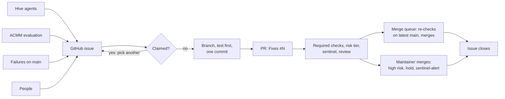

# Multi-agent orchestration

Several agents work on this repository at the same time: the Hive agents, Claude Code in CI, local agents a
maintainer runs, and the workflows that file and update issues. This page covers how they share the repository: who
does what, how work reaches them, how they keep out of each other's way, and where a person decides. How a single
agent works is set by [`AGENTS.md`](../AGENTS.md), which is authoritative. The security side is in
[`security/SECURITY-AI.md`](security/SECURITY-AI.md), and how to monitor agent work and debug it when it gets stuck in
[`ai-ops-runbook.md`](ai-ops-runbook.md).

## The agents

| Agent | Started by | Produces |
| --- | --- | --- |
| Hive agents, through the `hive-forge-app` GitHub App | Hive, on its own schedule, or an operator in the Hive dashboard | Issues titled `[<agent>] …` and labelled `agent/<agent>`; pull requests authored by `hive-forge-app` and labelled `hold` |
| Hive ACMM evaluation | An operator in the Hive dashboard | Issues titled `[ACMM L<n>] …` and labelled `acmm` and `origin/dashboard` |
| Claude Code in CI ([`claude.yml`](../.github/workflows/claude.yml)) | A triager labelling an issue `ai-fix-requested` (the label only counts when a person applies it), or an `@claude` mention from an owner, member or collaborator | A `claude/*` branch and a pull request, or a review |
| Local agents (Claude Code, omp, Copilot, Cursor) | A maintainer, on one issue | A `<type>/<number>-<slug>` branch and a pull request under the maintainer's account |
| Failures on `main` ([`auto-issues.yml`](../.github/workflows/auto-issues.yml)) | A failed or timed-out workflow run on `main` | A `ci` issue titled `<workflow> fails on main`, closed by the next successful run |
| Review suggestions ([`auto-review.yml`](../.github/workflows/auto-review.yml)) | A maintainer commenting `/apply-suggestions` on a pull request | A commit of the reviewers' suggestion blocks on the PR branch |

Each Hive agent covers one area; its issues show what it looks for:

| Hive agent | Looks for |
| --- | --- |
| `scanner` | Bugs, and docs that say something the code does not do |
| `craftsman` | Code quality and tech debt |
| `architect` | Duplication and structure across modules and config |
| `guide` | Gaps and errors in the user and contributor docs |
| `quality` | Behaviour that no test pins |
| `ci-maintainer` | CI health: flaky tests, red scheduled runs, a ruleset that drifted from its file |
| `operations` | Release and incident runbooks |
| `strategist` | Roadmap: distribution, discoverability, project health |
| `telemetry` | Runtime telemetry |

## How work flows

1. **One queue.** All agent work starts from a GitHub issue. One issue gets one branch, one Conventional Commit and one
   pull request whose body says `Fixes #<number>`. Work that turns up along the way becomes a new issue
   (`gh issue create`), not a second change in the same PR. How each change links back to its issue, and how to follow
   that link either way, is in [`agent-tasks/`](agent-tasks/README.md).
2. **Claim first.** An issue is taken when any of these holds; if one does, pick another issue:
   - it has an assignee (people and local agents claim with `gh issue edit <number> --add-assignee @me`);
   - a Hive agent's `<!-- hive:claim who=<agent> … until=<time> -->` comment is still before its `until` time (the
     claim lapses on its own if no PR appears by then), usually with a `hive/claimed-by-<agent>` label and
     `stage/020-claimed` or `stage/030-pr-in-progress`;
   - an open pull request references it (`🐝 covered by PR`, `stage/040-covered-by-pr`);
   - a Claude Code run for it is in progress in the `Claude Code` workflow (`gh run list --workflow claude.yml`).

   A pull request that references the issue overrides any claim.
3. **Respect the order.** A child or follow-up issue waits until its parent is done. Issues labelled `blocked`, `hold`
   or `stage/045-needs-decision` wait for a person.
4. **Same gates for everyone.** Agent pull requests run the same required checks as any other (`PR review rubric`,
   `Build, lint, test`, `Unit-test coverage floors`, `Static checks`, `End-to-end tests`) and get a
   [risk tier](risk-tiers.md).
5. **The merge queue or a person merges.** No agent merges its own work. The [merge queue](#merge-queue) merges a
   low- or medium-risk pull request once its required checks pass; a maintainer merges high-risk ones and any labelled
   `hold` (Hive's hold-gated mode puts it on every Hive pull request) or `sentinel-alert`. `.claude/settings.json` asks
   before `gh pr merge`.

## Merge queue

GitHub's own merge queue needs an organization-owned repository, so
[`merge-queue.yml`](../.github/workflows/merge-queue.yml) runs one on Actions. Whenever a workflow holding a required
check (`CI`, `Coverage gate`, `E2E`, `PR review rubric`) succeeds, a draft is marked ready, or `hold` or
`sentinel-alert` comes off a pull request, it takes the oldest open pull request that:

- comes from this repository, not a fork, and is not a draft;
- has neither a `hold` nor a `sentinel-alert` label;
- passes every required check (merge state `CLEAN`, so review threads are resolved too);
- is not high risk ([`risk-tiers.md`](risk-tiers.md)), rated by `main`'s `scripts/tier-classify.sh`.

It merges that pull request onto the current `main` and runs `./gradlew check assembleDebug` on the result; the
coverage floors and the emulator tests are not re-run there. That run executes the pull request's code with a read-only
token, and setup-gradle restores `main`'s Gradle cache without saving to it, so a pull request's build output does not
become the cache that `Release` and `Claude Code` restore. Only same-repo pull requests are picked, so this guards
against accidents, not against a hostile author. If the check passes and neither the pull request nor `main` moved,
it merges the pull request (a merge commit) and starts `CI`, `Coverage gate`, `E2E` and `Quality report` on `main`: a
merge made with `GITHUB_TOKEN` starts no push run, so without them a failure on `main` would go unnoticed.
`Release` is not started: it runs only for a change to `app/build.gradle.kts`, which is high risk, so a maintainer
merges it and the push starts the release. If the check fails, the pull request gets `hold` and a comment linking the
run; fix it and remove `hold` to queue it again. Each run starts the next, so the queue merges one pull request at a
time.

To keep a pull request out of the queue, add `hold` or leave it a draft. To drain the queue by hand:
`gh workflow run merge-queue.yml`. The logic lives in `scripts/merge-queue.sh`.

## Keeping parallel agents apart

- **Worktrees.** Agents working side by side on one machine each use their own git worktree under `worktrees/`
  (gitignored), on their own issue branch, and their own Gradle cache volume
  (`SANDBOX_GRADLE_VOLUME=minimalui-sandbox-gradle-2 scripts/sandbox-gradlew.sh …`, see
  [Running the gates](testing.md#running-the-gates)). Finished worktrees are removed (`AGENTS.md`, Session Completion).
- **Claude Code in CI** runs one job at a time per issue or pull request (concurrency group `claude-<number>`). A
  newer request replaces the pending one instead of running next to the active job.
- **Shared files.** `.claude/session-summary.md` is rewritten in each issue's own commit, so two PRs open at the same
  time conflict there. Resolve it by keeping the later session and carrying over the other's open follow-ups.

## Handing off between sessions

A new session starts from what the repository and the trackers hold:

| Where | What |
| --- | --- |
| The GitHub issue and its PR | Requirements, progress comments, review |
| `.claude/session-summary.md` | The latest session's outcome, open follow-ups and gotchas |
| `.claude/memory/corrections.tsv` | Each correction round a person had to make |
| [`reflections/`](reflections/README.md) | Why a non-obvious lesson holds |
| `bd remember` | Persistent knowledge in the beads tracker |

## Stage labels

Hive records where each issue and pull request stands with `stage/*` labels. Treat them as read-only: Hive sets them,
and the label descriptions on GitHub give their exact meaning.

| Stage | Means |
| --- | --- |
| `010-actionable` | Triaged; any agent may take it |
| `015-triage-needed`, `017-possible-existing` | Waiting for a maintainer to triage it or confirm the gap |
| `020-claimed`, `030-pr-in-progress` | An agent has it |
| `040-covered-by-pr` | An open PR covers it |
| `045-needs-decision`, `085-needs-decision`, `090-needs-human`, `090-ready-for-human-merge` | A person must act |
| `050-review-pending`, `060-reviewed` | Under review, or approved with a check still pending |
| `070-fixing`, `071-needs-author`, `072-returned-to-contributor`, `074-adopted-by-hive` | Checks red, changes requested or conflicts; the label names who fixes it |
| `080-awaiting-merge-admission`, `095-pre-merge-soak`, `100-merge-queue` | On the way to merge |
| `regressed`, `stalled` | Moved backwards, or in one stage too long |

## Where a person decides

- **What agents may work on:** only triagers can apply `ai-fix-requested`, and Claude Code in CI starts only when a
  person applies it (`github.event.sender.type == 'User'`): when `hive-forge-app` adds the label, the run is
  `skipped`. `claude-code-action` would refuse that sender anyway (`Workflow initiated by non-human actor`). To hand
  such an issue to Claude Code, a maintainer first checks that no agent holds it (`hive/claimed-by-<agent>`,
  `hive/in-progress` or `stage/020-claimed` and up), then removes the label and adds it again.
  `stage/015-triage-needed` waits for a maintainer's triage label.
- **Sensitive changes:** Hive labels a pull request that touches workflows, policies, Hive config or security docs
  `sentinel-alert` and does not approve or auto-merge it while the label is present; neither does the merge queue. A
  maintainer removes the label after reviewing the change.
- **Dependencies:** any dependency or plugin change needs explicit approval (`AGENTS.md`, Dependency Management).
- **Merges and the ruleset:** a maintainer merges every high-risk pull request and every one labelled `hold` or
  `sentinel-alert`; the merge queue merges the rest. A maintainer applies `.github/rulesets/main.json` after a change to
  it lands.

## Measuring it

The weekly `PR metrics` workflow reports how many agent-authored pull requests (`claude/*` branches and
`hive-forge-app`) were merged and how many were closed unmerged; see [`metrics/README.md`](metrics/README.md). A falling
rate means the instructions, prompts or skills need another look. The weekly `AI audit trail` workflow records which
agent and model are behind each pull request merged into `main`, and who merged it
([`metrics/README.md`](metrics/README.md#ai-audit-trail)).

The weekly `Strategy report` workflow shows whether the agents keep up: issues opened against issues closed, the open
backlog per stage label, and the ACMM gaps still open per level. A stage where issues pile up is where work stalls.
